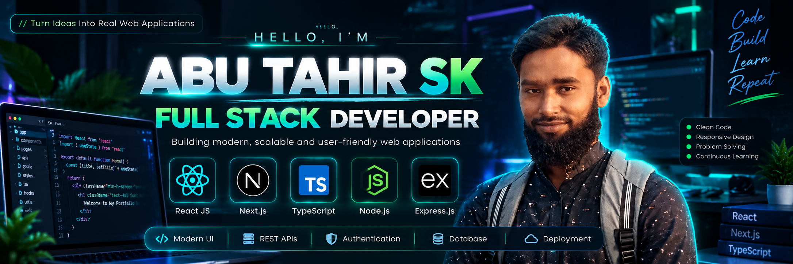

  <!-- Profile Image -->
  
  
   
  
  <!-- Typing Intro -->
  

  
<b>Transforming innovative ideas into high-performance, user-centric web applications.</b>

  <!-- Social Badges -->
  

    
    
    
    
  

 

### 👨‍💻 About Me

Hello there! I'm Abu Tahir Sk, a results-driven Full Stack Developer. My expertise lies in the MERN stack and Next.js, where I transform complex problems into elegant, user-centric digital solutions. I'm passionate about writing clean, scalable code, solving real-world problems, and creating seamless digital experiences.

 

### 💡 My Tech Journal

<table width="100%">
  <tr>
    <td width="50%" align="center">
      <h4>🎨 Frontend</h4>
      
    </td>
    <td width="50%" align="center">
      <h4>⚙️ Backend</h4>
      
    </td>
  </tr>
  <tr>
    <td width="50%" align="center">
      <h4>🗄️ Database & Cloud</h4>
      
    </td>
    <td width="50%" align="center">
      <h4>🛠️ Tools & Practices</h4>
      
    </td>
  </tr>
</table>

 

### 🚀 Featured Projects

<table width="100%">
  <tr>
    <td width="50%" valign="top">
      <h4>📄 DocuFlow / DocuCraft Pro</h4>
      
Developed a robust document management and invoice generation SaaS platform allowing custom PDF formatting, OTP email workflows, and seamless user management.

      
<b>Tech Stack:</b> Next.js, Prisma, Tailwind CSS, Node.js

      <a href="YOUR_LIVE_SITE_LINK">🔗 Live Site</a> | <a href="YOUR_GITHUB_REPO_LINK">💻 Source Code</a>
    </td>
    <td width="50%" valign="top">
      <h4>🛒 Gadget Heaven</h4>
      
Built a responsive e-commerce platform offering a seamless shopping experience with advanced cart features, product filtering, and user authentication.

      
<b>Tech Stack:</b> React, Node.js, Firebase, MongoDB

      <a href="YOUR_LIVE_SITE_LINK">🔗 Live Site</a> | <a href="YOUR_GITHUB_REPO_LINK">💻 Source Code</a>
    </td>
  </tr>
</table>

 

### 🎯 Current Focus & Open Source

I am a firm believer in lifelong learning and collaborative development. Currently, I am sharpening my skills in:
- **Next.js & Server Actions:** Building advanced, scalable, server-rendered applications.
- **Enterprise UI/UX:** Designing clean interfaces utilizing dark mode and glassmorphism.
- **Database Optimization:** Leveraging Prisma and MongoDB for efficient data fetching.

 

### 🌌 My GitHub Universe

  
  
  
    
  
  

 

  <h3>🤝 Let's Collaborate & Innovate!</h3>
  
I'm always thrilled to connect with fellow developers, designers, and tech enthusiasts. Feel free to reach out for a project, collaboration, or just to chat about the latest in tech!

  

