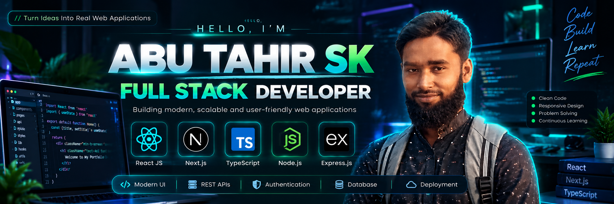

  <!-- 🌟 Custom Premium Hero Banner with Full Stack Web Developer Branding -->
  

    
  

  <!-- ✍️ Dynamic Glowing Typing Introduction -->
  

  <!-- 🌐 Social Media & Live Links (All Working & Connected) -->
  

    
    
    
    
  

  <!-- ⚡ Live Status & Metrics Badges -->
  

    
    
    
  

  <!-- ⚡ Cyan/Emerald Animated Divider -->
  

### 👨‍💻 About Me

Hello! I'm **Abu Tahir Sk**, a dedicated **Full Stack Web Developer** focused on building high-performance, user-centric web applications and scalable backend systems. I specialize in bridging intuitive frontend interfaces with reliable, data-driven cloud architectures.

- 🔭 **Current Focus:** Engineering production-ready SaaS tools, e-commerce solutions, and dynamic CMS architectures.
- 💡 **Core Strengths:** Next.js (App Router), React, TypeScript, Node.js, Express, PostgreSQL (Neon Serverless), Prisma ORM, and MongoDB.
- 🌱 **Growth Mindset:** Exploring advanced system design, database indexing, caching strategies, and modern cloud deployment patterns.
- ⚡ **Philosophy:** *“Clean code, robust architectures, and memorable user experiences.”*

  

### 💻 Technology Dashboard

<table width="100%">
  <tr>
    <td width="50%" align="center" valign="top">
      <h4 style="color: #00FFFF;">🎨 Frontend Engineering</h4>
      
    </td>
    <td width="50%" align="center" valign="top">
      <h4 style="color: #00FFFF;">⚙️ Backend Architecture</h4>
      
        
      
      
      
    </td>
  </tr>
  <tr>
    <td width="50%" align="center" valign="top">
      <h4 style="color: #00FFFF;">🗄️ Database & Cloud Services</h4>
      
        
      
      
    </td>
    <td width="50%" align="center" valign="top">
      <h4 style="color: #00FFFF;">🛠️ Dev Tools & Workflow</h4>
      
    </td>
  </tr>
</table>

  

### 🚀 Featured Engineering Projects

<table width="100%">
  <tr>
    <td width="50%" valign="top">
      <h4>📄 <a href="https://github.com/abu-tahir-sk/docuflow">DocuFlow / DocuCraft Pro</a></h4>
      
Comprehensive document management and automated invoice generation SaaS platform with dynamic templating and export workflows.

      

        
        
        
      

      <a href="https://github.com/abu-tahir-sk/docuflow">🔗 Repository</a> | <a href="https://github.com/abu-tahir-sk/docuCraft-2">📦 DocuCraft-2</a>
    </td>
    <td width="50%" valign="top">
      <h4>🌐 <a href="https://github.com/abu-tahir-sk/abu-tahir-s">Portfolio CMS Platform</a></h4>
      
Modern production-grade developer portfolio featuring a secure dynamic Admin CMS, Neon PostgreSQL, Prisma ORM, and Jose JWT authentication.

      

        
        
        
      

      <a href="https://github.com/abu-tahir-sk/abu-tahir-s">🔗 Repository</a> | <a href="https://abu-tahir-s.vercel.app/">🌐 Live Demo</a>
    </td>
  </tr>
  <tr>
    <td width="50%" valign="top">
      <h4>🛒 <a href="https://github.com/abu-tahir-sk/shopora">Shopora E-Commerce</a></h4>
      
Responsive and sleek online marketplace platform featuring dynamic catalog filtering, shopping cart management, and seamless UI transitions.

      

        
        
        
      

      <a href="https://github.com/abu-tahir-sk/shopora">🔗 Repository</a>
    </td>
    <td width="50%" valign="top">
      <h4>💼 <a href="https://github.com/abu-tahir-sk/job-portal-client">Full Stack Job Portal</a></h4>
      
End-to-end job board connecting candidates with recruiters, featuring authenticated user dashboards, role tracking, and application management.

      

        
        
        
      

      <a href="https://github.com/abu-tahir-sk/job-portal-client">🔗 Client</a> | <a href="https://github.com/abu-tahir-sk/job-portal-server">⚙️ Server</a>
    </td>
  </tr>
  <tr>
    <td width="50%" valign="top">
      <h4>📊 <a href="https://github.com/abu-tahir-sk/expense-Tracker">Expense & Budget Tracker</a></h4>
      
Real-time financial management application with dynamic categorization, daily expense logging, and interactive data insights.

      

        
        
      

      <a href="https://github.com/abu-tahir-sk/expense-Tracker">🔗 Repository</a>
    </td>
    <td width="50%" valign="top">
      <h4>🏃 <a href="https://github.com/abu-tahir-sk/fit-log">FitLog Habit & Fitness Tracker</a></h4>
      
Interactive wellness and habit tracking application designed for recording routine exercise goals and daily progress tracking.

      

        
        
      

      <a href="https://github.com/abu-tahir-sk/fit-log">🔗 Repository</a>
    </td>
  </tr>
</table>

  

### 📊 GitHub Statistics & Real-time Metrics

  <!-- GitHub Stats & Streak Cards in Dark Theme with Cyan/Emerald accents -->
  
  

    
  
  <!-- Top Languages & Activity Graph -->
  
  

   
  

    <i>“Code is like art — your logic is your brush, and every commit shapes the future.” 🎨</i>
  

   

  <!-- 🌊 Subtle Animated Waves Footer -->
  

